<p align="center">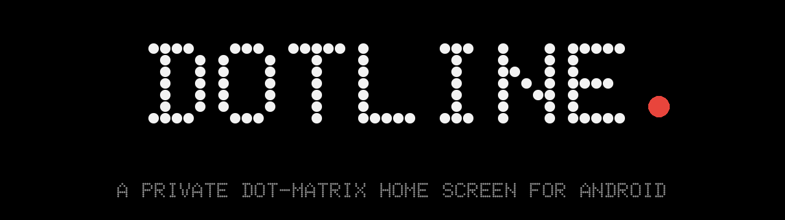</p>

<p align="center">
A fast, private Android home screen in a black, dot-matrix style.<br>
No internet permission. No ads. No tracking. Everything stays on the phone.
</p>

<p align="center">
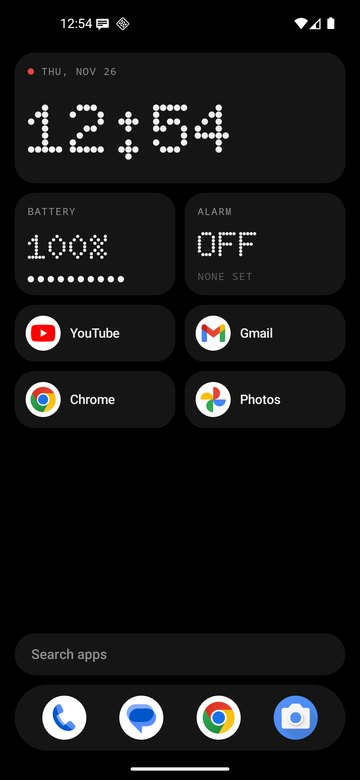
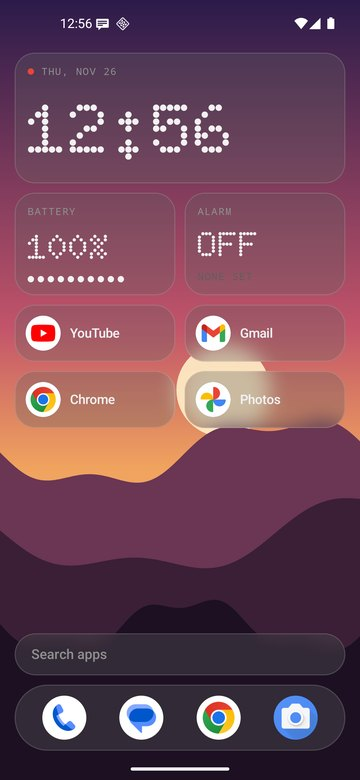
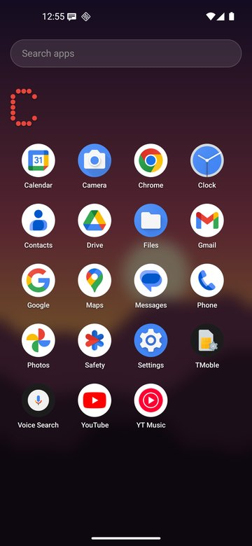
</p>

## What it does

**Home.** A round-dot clock, live battery and next-alarm tiles, four favourite apps, a search bar and a dock. Tap the clock, battery or alarm tile to open the matching app or setting.

**All apps.** Swipe up. Real app icons, a big dot letter for the section you're in, and a slim scroll handle on the right edge: drag it and a drop-shaped bubble shows the letter as you fly through the list. Pull down (or press Home) to close.

**Search.** Type a few letters and press Enter to open the top match. It understands prefixes, word starts ("maps" finds Google Maps), initials ("ps" finds Play Store) and accents. It also answers sums (`12*8`) and finds phone settings ("wifi", "battery"), all offline.

**Quick page.** Swipe right for a dot calendar, free storage, live RAM use and four quick-open apps. Each tile opens its app (Calendar, Files, memory details).

**Look.** Pick a wallpaper (your own photo, or one of five drawn by Dotline: Dot field, Halftone, Sunset, Glow, Horizon), a tile style (smoke glass, clear glass, tinted, outline, floating, solid), the text colour on tiles (auto, white or black), the app list background, seven accent colours and round or rounded-square icons. Live previews show home and the app list as you change things.

**Now playing** (optional). Spotify, or any music app, on your home in one of three styles, with play/pause, skip, a progress bar you can drag and a speaker chip that opens Android's own speaker picker.

<p align="center">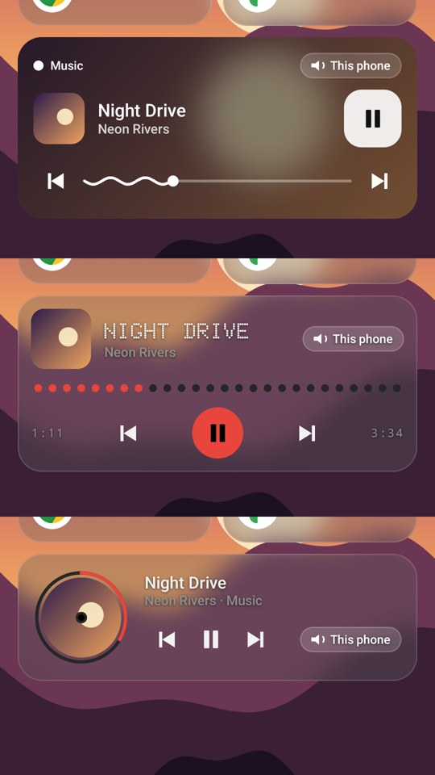</p>

<p align="center">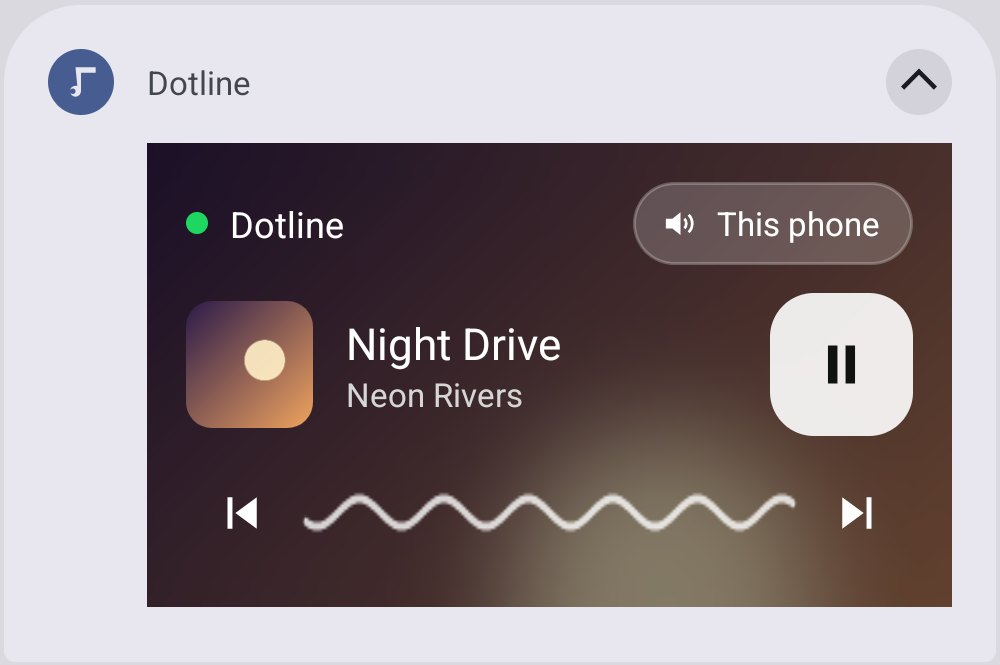</p>

Switch on **Show this player there too** and the same player (Cover glow) also sits in the pull-down panel and on the lock screen. Turn off Spotify's own playback notifications if you only want Dotline's.

**Notification dots** (optional). A small accent dot on the apps you choose while they have notifications.

**Lock screen and clock.** Put the chosen wallpaper on the lock screen, open a full-screen Night clock (shows over the lock screen like an alarm, never unlocks anything), or use the dot clock as the screensaver while charging.

**Panel tiles.** "Next wallpaper" and "RAM" tiles for the phone's pull-down panel.

**Your layout.** Pick 4, 6 or 8 home apps, a compact icon-only layout, Big / Stacked / Small clock styles, and folders (drop one app on another in edit mode). Icons can be the apps' own colours or one-colour "dot" icons in white or your accent colour (on Android 12 Dotline makes them itself). Swipe down on home for notifications. The battery turns orange at 20%, red at 10% and green while charging. Tile text checks the wallpaper right behind each tile, so it stays readable on any photo.

**Backup.** Settings → About saves your whole setup to a file you choose, and loads it back.

**Long-press any app** for app info, add or remove from home, dock or quick open, hide, notification dot, or uninstall (Android asks you to confirm). **Long-press empty space** to move things: drag the grips to reorder the clock, battery and alarm, your apps and the player, or drag an app onto another (or onto the dock) to swap them. Settings is in the same bar.

<p align="center">
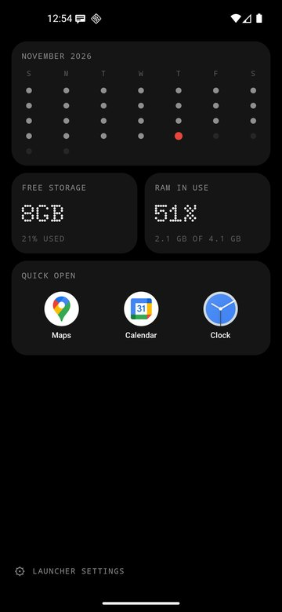
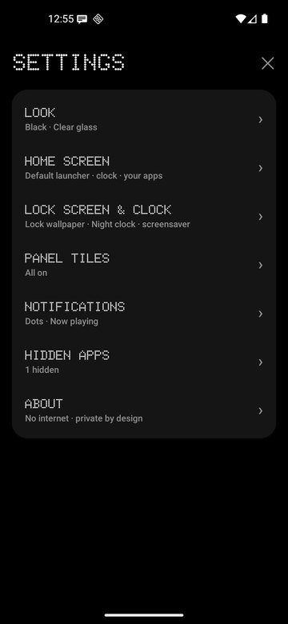
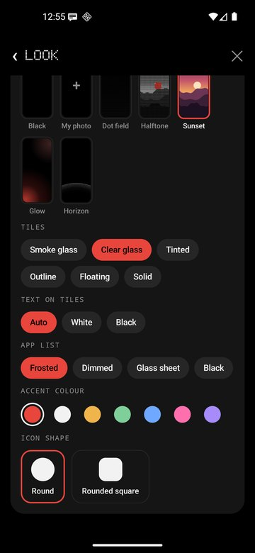
</p>

## Design sketches

Drawn while planning Dotline, before the code: the five built-in wallpapers on home and lock screen, the tile styles, the app list backgrounds and the three players. The app does all of these; the screenshots above are the real thing.

<p align="center">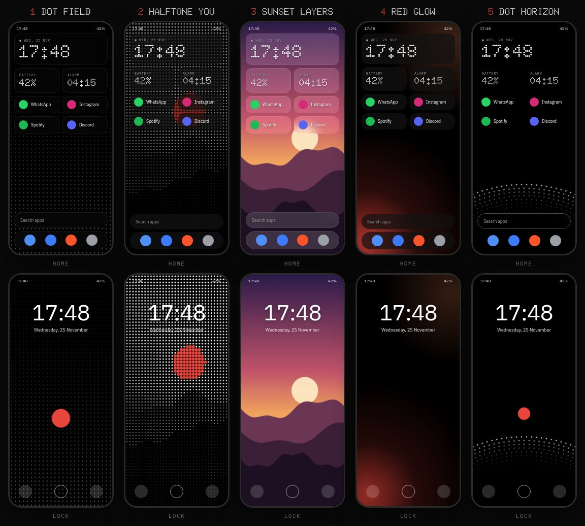</p>
<p align="center">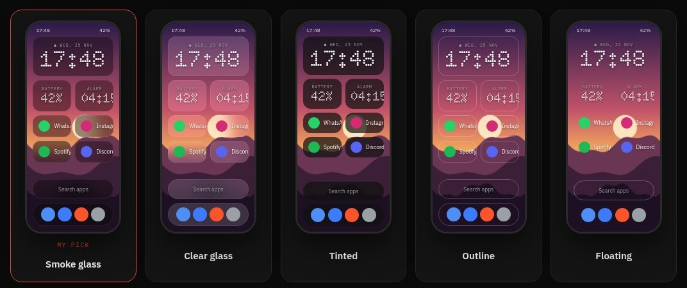</p>
<p align="center">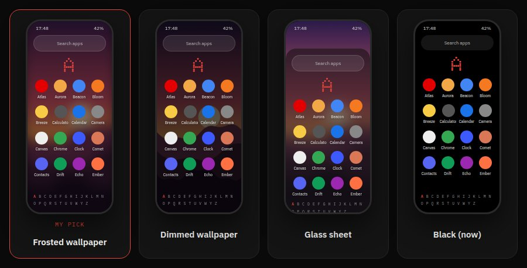</p>
<p align="center">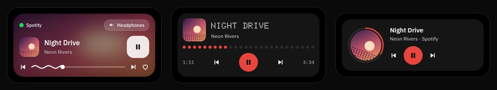</p>

## Private by design

Dotline has **no internet permission**, so nothing it sees can leave the phone. Settings and a photo you pick stay in the app's private storage.

| What | Why | When |
|---|---|---|
| `REQUEST_DELETE_PACKAGES` | Opens Android's own "Uninstall this app?" screen | Only when you tap Uninstall, and you still confirm |
| `SET_WALLPAPER` | Puts the chosen look on the lock screen | Only when you tap Set; it can't read any wallpaper |
| Notification access | Dots on chosen apps and Now playing | Off by default. You allow it in Android's settings; Dotline keeps only which apps have a notification and the current song, never notification text |
| `POST_NOTIFICATIONS` | The optional player card in the pull-down panel and on the lock screen | Off by default. Only after you switch it on, and Android asks you first |
| `EXPAND_STATUS_BAR` | Swipe down on home opens the notification panel | Only that; it can't read anything. Switch it off in Settings |
| Photo picker | My photo and Halftone wallpapers | Android's picker hands over only the one photo you choose |

There is no accessibility service, device admin, analytics, crash reporting or ads. [`scripts/check-permissions.sh`](scripts/check-permissions.sh) fails if any other permission appears in the APK.

## Build

Requirements: JDK 17+ and the Android SDK (platform 36). Runs on Android 10 and newer.

```bash
./gradlew assembleDebug                 # debug APK
./gradlew assembleRelease               # shrunk release APK (about 2 MB)
scripts/check-permissions.sh            # privacy check (debug APK by default)
scripts/check-permissions.sh app/build/outputs/apk/release/app-release.apk
```

Release signing reads `~/.config/dotline/keystore.properties` (or the path in `DOTLINE_KEYSTORE_PROPERTIES`). The signing key is never stored in this repository; without it, release builds are unsigned.

## Tests

```bash
./gradlew testDebugUnitTest             # search, sections, pins, calendar, halftone, blur, dots
./gradlew connectedDebugAndroidTest     # 51 tests that drive the launcher on a device or emulator
```

The device tests cover the home screen, search, the app list and its scroll handle, every settings page, wallpapers, panel tiles, the screensaver, notification dots, and all three player styles through a real media session.

## Performance

Measured on a mid-range phone (60 Hz):

- 99% of frames on time while scrolling the app list (median frame 8 ms).
- Opens in about 0.3 s.
- Uses less memory than the phone's own launcher.
- Glass tiles reuse a blurred copy made once per wallpaper, so scrolling never re-blurs.

## Undo

Settings → Home screen → Default launcher → **Change**, or on the phone: Settings → Apps → Default apps → Home screen.

## Credits

Dot-matrix font: [Doto](https://github.com/oliverlalan/Doto), SIL Open Font License 1.1 (see `licenses/OFL-Doto.txt`). Screenshots are from the Android emulator.
